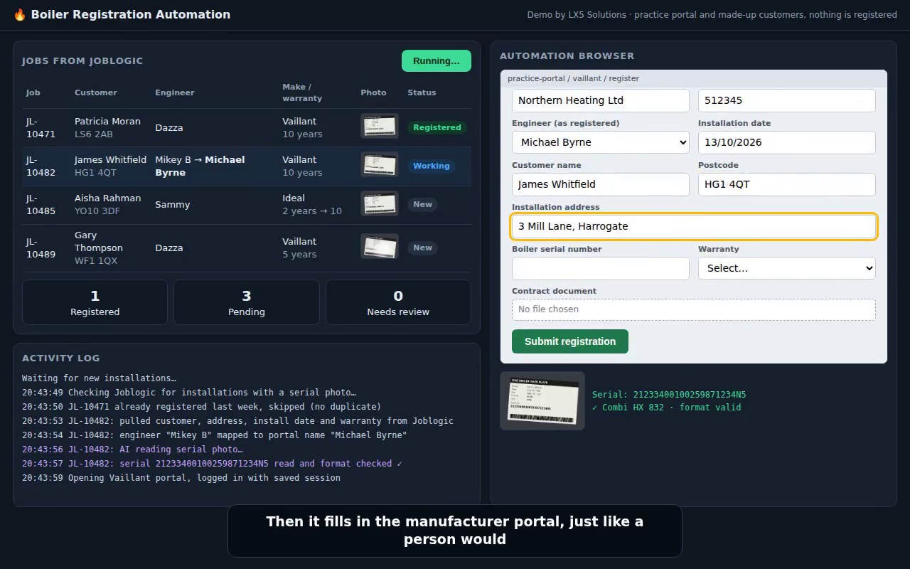
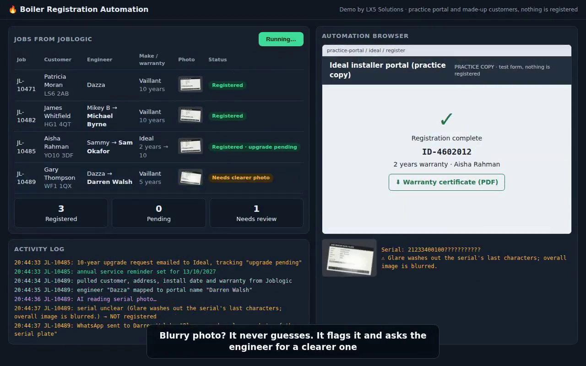
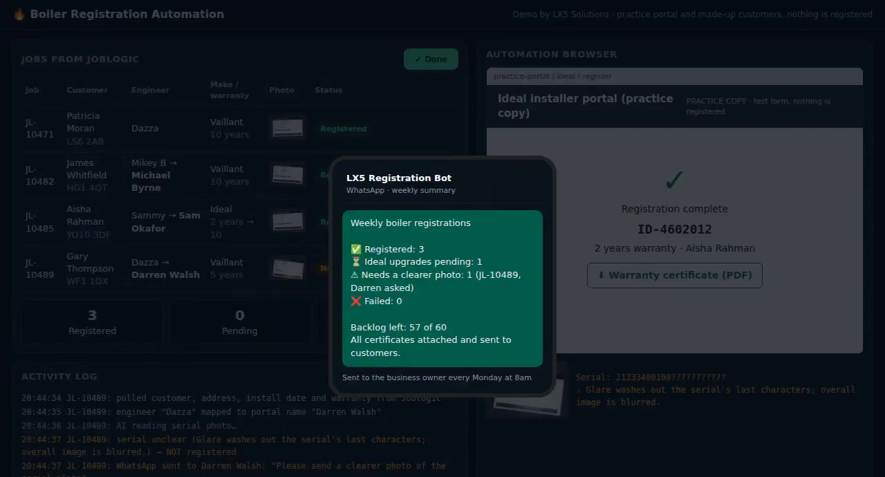
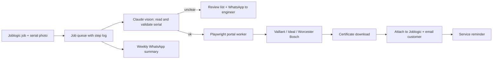

# 🔥 Boiler Registration Automation

**Turns a photo of a boiler serial plate into a finished warranty registration, with no typing.**

Heating installers lose hours every week registering boilers by hand on manufacturer portals (Vaillant, Ideal, Worcester Bosch), then copying certificates back into their job system. This automation does all of it, and flags anything it isn't sure about instead of guessing.

▶️ **[Watch the 1-minute demo](https://lx5solutions.com/demos/video/boiler-registration-demo.mp4)** · 🖱️ **[Try the live demo](https://lx5solutions.com/demos/boiler/)**



## What it does

| Step | What happens |
|---|---|
| 1. Pick up the job | New installs come in from the job system (Joblogic) with the serial photo, customer, address, install date, engineer and warranty |
| 2. Read the serial | Claude vision reads the serial plate and checks the format. Blurry or glared photos are **flagged, never guessed** |
| 3. Map engineers | Nicknames ("Dazza") are mapped to the names the portal expects ("Darren Walsh") |
| 4. Register | A browser automation fills in the correct manufacturer portal and uploads the contract document |
| 5. Close the loop | The certificate is attached to the job, the customer is emailed through the job system, and the annual service reminder is set |
| 6. Track upgrades | Ideal 2-year → 10-year upgrade requests are tracked until confirmed |
| 7. Report | The owner gets a weekly WhatsApp summary: registered, pending, needs review, failed |



## Built to be safe

- **No duplicates.** Every job moves through recorded steps, so a failed run resumes where it stopped and never registers twice.
- **Two-factor login is respected.** The owner approves 2FA prompts; nothing is bypassed.
- **Human in the loop** for unclear photos and, optionally, for the first live registrations.
- **Dry-run mode** fills every portal form and stops before submitting, with screenshots for review.



## Architecture (production version)



## Run the demo

```bash
npm install
npm start          # http://localhost:3000
```

Set `ANTHROPIC_API_KEY` to read the photos live with Claude; without it, the demo uses recorded results.

> This repository is a **demonstration** running on a practice portal with made-up customers. Nothing is registered with any manufacturer. Manufacturer names are used only to describe compatibility.

---

Built by **[LX5 Solutions](https://lx5solutions.com)**, custom AI automations for trade businesses. Need something like this built for your business? Get in touch through the website.
